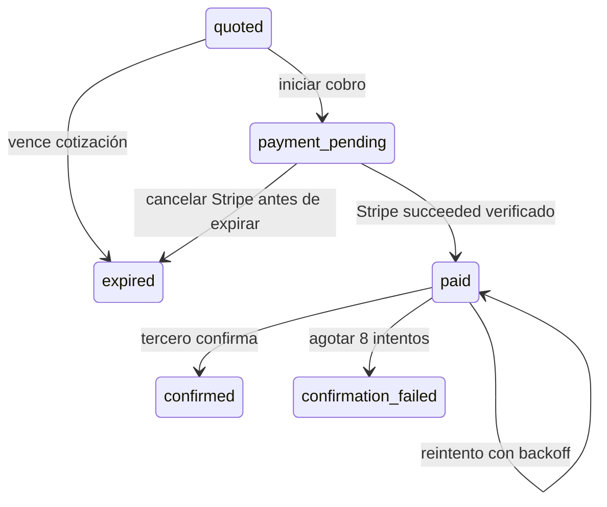

# Pagos externos / SeguriPass

Base de backend para #17, #19–24 y #34. **La integración real sigue pendiente de #18**: todavía no existen documentación, QR de ejemplo ni credenciales del proveedor. Las rutas de cotización devuelven `503 EXTERNAL_PROVIDER_NOT_CONFIGURED` hasta conectar un protocolo real. No hay proveedor simulado accesible desde la API ni cobros ficticios en runtime.

## Responsabilidad y extensión

Todo el flujo vive en ADMINISTRATIVO. SeguriPass es dueño de sus tickets, tarifas y operación física; Viggo guarda una cotización, cobra y confirma el pago. No se crean tickets ni comandos de barrera en OPERATIVO. No hay cambios en web o Flutter.

- `src/domain/external-payments`: contratos del proveedor, repositorio y gateway; orquestación independiente de Express, Prisma y Stripe.
- `src/infrastructure/repositories/payments/external-order.repository.postgres.ts`: órdenes, auditoría, pagos y leases en PostgreSQL.
- `src/infrastructure/external-payments/stripe-external.gateway.ts`: PaymentIntent real con una clave estable por orden.
- `src/infrastructure/external-payments/seguripass.client.ts`: transporte HTTPS con timeout; el contrato `SeguripassProtocol` traduce requests y respuestas reales al dominio.
- `src/presentation/dependencies/external-payments.dependencies.ts`: punto donde conectar el protocolo y configuración del proveedor.
- Worker: cada 15 segundos, lotes de hasta 50 órdenes. Verifica cobros pendientes en Stripe y confirma al tercero después de `succeeded`. Espera trabajos activos durante el cierre del servidor.

Para otro proveedor, implementar `ExternalPaymentProvider` y registrarlo en dependencies. No hace falta cambiar las reglas del servicio, Stripe ni las tablas.

## API para el futuro cliente móvil

Todas las rutas requieren el JWT normal de Viggo para `OPERATIVE_MOBILE`; el usuario siempre sale de la sesión.

| Método y ruta | Entrada / resultado |
| --- | --- |
| `POST /api/external-payments/orders` | `{ "provider": "seguripass", "qr": "<texto opaco>" }`; devuelve la cotización normalizada y el ID de orden. |
| `GET /api/external-payments/orders/:id` | Estado de una orden propia. |
| `POST /api/external-payments/orders/:id/payment-intent` | Sin monto en el body. Devuelve `orderId`, `paymentIntentId`, `paymentIntent` (client secret) y `status`. |

La orden pública incluye `id`, `provider`, `ticket`, `parking: { id, name }`, `amountMinor`, `currency`, `expiresAt` y `status`. `amountMinor` son centavos enteros; `expiresAt` es epoch en milisegundos. Esta primera versión acepta MXN y montos de 1,000 a 99,999,999 centavos; estos límites están en el servicio y en los CHECK de la migración. Confirmar límites de operación y liquidación antes de habilitar el proveedor.

`provider` se solicita explícitamente mientras no tengamos el formato oficial del QR para detectar su origen. El contenido del QR nunca fija el monto ni un URL de destino. No hay endpoint móvil que pueda marcar el pago como exitoso.

La creación del PaymentIntent es idempotente **por orden**, independientemente de claves elegidas por el cliente. No exige `Idempotency-Key` del móvil porque la misma orden siempre representa el mismo cobro. El gateway usa `external-intent:<orderId>` en Stripe y guarda `type=external`, `externalOrderId`, `usuario` y `provider` en metadata. Puede usarse el client secret con PaymentSheet sin Customer/ephemeral key; no se agrega guardado de tarjetas.

## Estados y garantías



- Unicidad `(provider, reference)` y dueño inmutable. Un QR repetido recupera la misma orden, sin cambiar monto o vigencia; otro usuario recibe 404. La referencia debe identificar de forma estable y única un ticket/cotización según el contrato del proveedor.
- Una referencia expirada o ya pagada no se reutiliza automáticamente ni permite otro cobro. Falta acordar si SeguriPass emite una nueva referencia al recotizar. También falta acordar autorización del poseedor del QR y liberación de reservas abandonadas; no asumir que escanear prueba propiedad del ticket.
- Importes enteros en el dominio y `numeric(12,2)` en `payments`; no se mezcla la identidad del parking externo con un proyecto Viggo.
- Se valida orden, usuario, importe, moneda e ID de PaymentIntent antes de aplicar un éxito de Stripe. El webhook conserva la verificación de firma sobre el body crudo.
- Persistencia del inicio antes de llamar a Stripe; claves estables al recuperar respuestas perdidas. Si no se conoce el ID después de 23 horas, se abre un incidente y se bloquea la recreación automática. Stripe [puede eliminar claves de idempotencia después de 24 horas](https://docs.stripe.com/api/idempotent_requests). Una vez conocido el ID, solo se recupera ese intento.
- El pago exitoso y la orden `paid` se guardan juntos en una transacción, también si el webhook llega antes de guardar la respuesta de creación. Los duplicados no reinician confirmación ni revisión.
- Cada confirmación obtiene un lease de 60 segundos, con token distinto por intento; los resultados de un worker desplazado no sobrescriben al actual. No se mantiene una transacción de base durante llamadas HTTP.
- Confirmación con clave `external-confirm:<orderId>`, backoff exponencial desde 5 segundos, máximo 8 intentos; una caída tras aplicar el pago remotamente exige idempotencia del proveedor. Debe comprobarse esta garantía en su sandbox antes de habilitarlo.
- Al agotar intentos: `confirmation_failed`, pago sigue `succeeded`, conciliación `failed` e incidente `EXTERNAL_PAYMENT_REVIEW`. No se presenta como pago confirmado en el tercero ni se cobra de nuevo.
- Auditoría append-only de cotización, inicio, vinculación del intento, pago, confirmación, errores y expiración. No almacena QRs, secretos de Stripe, credenciales ni respuestas crudas.
- La conciliación existente de tickets/pensiones excluye `external`. El historial normal del usuario sí incluye el nuevo tipo.

`refunded` está reservado en el modelo. **No hay automatización de devoluciones, reintento manual ni conciliación contra un endpoint de estado de SeguriPass todavía**: hay que acordar políticas y contrato primero. La revisión usa las rutas existentes de incidentes para ADMIN_WEB; el parking externo no se asigna a un proyecto Viggo. No cerrar #18 ni declarar lista para producción la integración por pasar las pruebas simuladas.

## Cuando llegue la documentación

1. Obtener QR válidos/erróneos, sandbox y credenciales. Confirmar unicidad y ciclo de vida de referencias, importe final, moneda, vigencia y errores.
2. Implementar `SeguripassProtocol`: rutas, payloads y normalización de quote/confirmación. El cliente HTTP actual envía POST JSON y headers configurados; adaptar transporte si exigen GET, firmas por petición u otro esquema de autenticación. Los endpoints `/fake/*` existen solo en pruebas.
3. Cargar URL y credenciales desde configuración de servidor; inyectarlas en dependencies sin valores hardcodeados. El transporte impide redirects y destinos fuera del origen configurado.
4. Acordar idempotencia, consulta de estado tras timeouts, ventanas de confirmación, rate limits, comisiones, liquidación, cancelaciones, reembolsos y webhooks del tercero. Añadir esas capacidades cuando exista contrato.
5. Probar con Stripe test real, webhook real y sandbox SeguriPass; probar pago durante expiración, doble escaneo, confirmación aplicada con respuesta perdida y recuperación después de caídas.
6. Añadir configuración operativa de intervalos/límites, métricas y herramientas de revisión/reembolso antes de producción.

## Validación y migración

```sh
npm run check
npm test
```

La suite `tests/integration/external-payments.test.ts` usa PostgreSQL `_test`, proveedor HTTP local y gateway Stripe en memoria. Prueba autenticación/aislamiento, importes del servidor, concurrencia, pérdida de respuestas, recuperación de webhook, firma real con secreto de prueba, duplicados, expiración/cancelación, leases y revisión tras fallos. No hace llamadas a Stripe ni SeguriPass reales.

La migración `20261016090000_external_payments` crea órdenes y auditoría, agrega tipos de pago/incidente e índices. El runner la aplica únicamente en la base de pruebas. Para llevar la funcionalidad a otro entorno hay que desplegar esa migración antes de iniciar el backend actualizado mediante el procedimiento normal del proyecto (`npm run db:migrate:deploy`).
