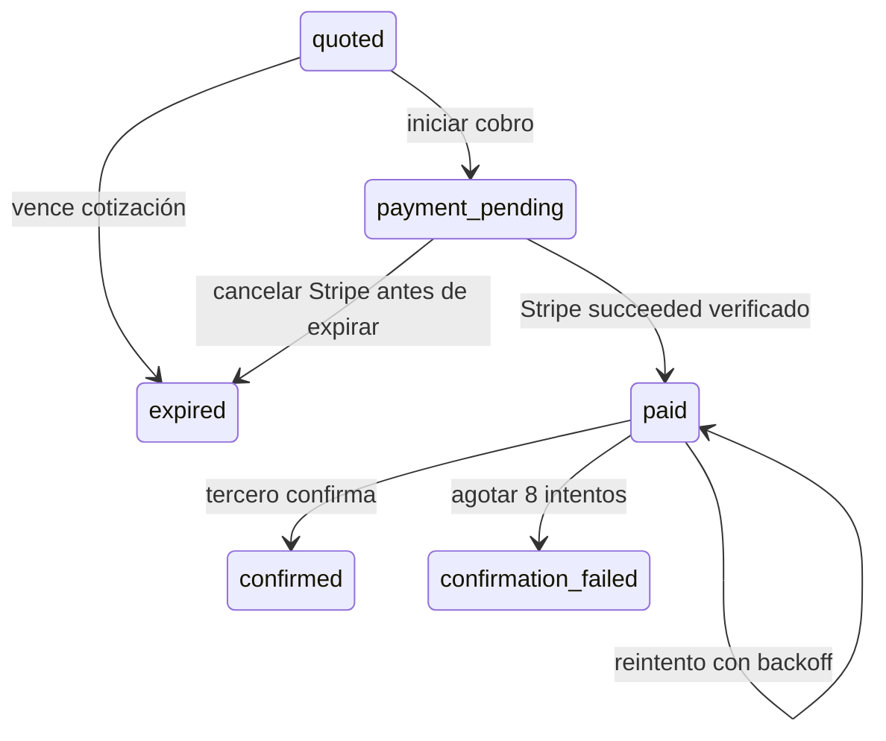

# Pagos externos (proveedores de estacionamiento)

Cobro desde la app en estacionamientos que opera otro proveedor (#17). **Cada estacionamiento es un proyecto de Viggo ligado a un proveedor del catálogo** (*Proveedores* en la web): el proveedor decide cómo se cobra.

| Integración del proveedor | Cómo cobra |
| --- | --- |
| `viggo` | Flujo propio con OPERATIVO (tickets, entrada y salida). No usa este módulo: `POST /orders` responde `409 VIGGO_TICKET_FLOW`. |
| `standard` | El proveedor implementa la [API de proveedores Viggo](api-proveedores.md); se configura solo con URL y credencial. |
| `adapter` | El proveedor tiene su propia API: se configura cómo es (`apiMapping`, ver [Adaptador configurable](#adaptador-configurable)) y un motor genérico traduce. Sin mapeo responde `503 EXTERNAL_PROVIDER_NOT_CONFIGURED`. |

La configuración (URL, credencial cifrada, activo, tiempo de espera, mapeo) se lee en cada llamada, así que se puede cambiar sin reiniciar. No hay cobros ficticios en runtime.

## Responsabilidad y extensión

Todo el flujo vive en ADMINISTRATIVO. El proveedor es dueño de sus tickets, tarifas y operación física; Viggo guarda una cotización, cobra y confirma el pago. No se crean tickets ni comandos de barrera en OPERATIVO.

- `src/domain/external-payments`: contratos del proveedor, repositorio y gateway; orquestación independiente de Express, Prisma y Stripe.
- `src/infrastructure/repositories/payments/external-order.repository.postgres.ts`: órdenes, auditoría, pagos y leases en PostgreSQL.
- `src/infrastructure/external-payments/stripe-external.gateway.ts`: PaymentIntent real con una clave estable por orden.
- `src/infrastructure/external-payments/http-provider.client.ts`: cliente HTTPS genérico (timeout, sin redirecciones, reintentos de cotización, errores traducidos al dominio); lo que cambia por proveedor es solo el `ProviderProtocol`.
- `src/infrastructure/external-payments/standard-provider.protocol.ts`: protocolo de la API de proveedores Viggo v1.
- `src/infrastructure/external-payments/mapped-provider.protocol.ts`: adaptador genérico; habla la API de un proveedor a partir de su mapeo (`src/domain/entities/parking/provider-api-mapping.ts`).
- `src/infrastructure/external-payments/provider-directory.postgres.ts`: arma la integración del proveedor del proyecto a partir del catálogo.
- Worker: cada 15 segundos, lotes de hasta 50 órdenes. Verifica cobros pendientes en Stripe y confirma al tercero después de `succeeded`. Espera trabajos activos durante el cierre del servidor.

Un proveedor que implementa el estándar o cuya API se puede describir con un mapeo se da de alta solo en el catálogo. Solo lo que un mapeo no puede expresar (firmas por petición, OAuth, XML) se programa como extensión: un `ProviderProtocol` en `EXTENSIONS` del directorio y su nombre en `PAYMENT_PROVIDER_EXTENSIONS`; el proveedor lo indica en `adapter`. No hace falta cambiar las reglas del servicio, Stripe ni las tablas.

## Adaptador configurable

`apiMapping` (JSON) describe las dos llamadas. Las rutas son relativas a `baseUrl` y no pueden salir de ella (sin `/` inicial, `..` ni otro dominio). Las variables `{nombre}` se codifican en la ruta, así que un QR no puede alterarla; en el cuerpo, un texto que es solo una variable conserva su tipo (`"{amount}"` → `85.5`).

```json
{
  "quote": {
    "method": "GET",
    "path": "boletos/{qr}?estacionamiento={parkingId}",
    "response": {
      "reference": "data.folio", "ticket": "data.boleto.numero", "parkingName": "data.plaza",
      "amount": "data.importe", "amountUnit": "pesos", "currency": "data.moneda",
      "expiresAt": "data.vence", "expiresFormat": "unixSeconds",
      "status": "data.estatus", "statusValues": { "PENDIENTE": "payable", "PAGADO": "paid", "VENCIDO": "expired" }
    }
  },
  "confirm": {
    "method": "PUT",
    "path": "boletos/{reference}/pago",
    "body": { "monto": "{amount}", "referenciaPago": "{paymentReference}" },
    "idempotencyHeader": "X-Clave-Unica",
    "response": { "confirmationReference": "resultado.comprobante" }
  }
}
```

| Campo | Valores |
| --- | --- |
| `quote.method` / `confirm.method` | `GET`, `POST` / `POST`, `PUT`, `PATCH` (el cuerpo no aplica a GET). |
| Variables de cotizar | `{qr}`, `{parkingId}` (el ID del estacionamiento en el proveedor). |
| Variables de confirmar | `{reference}`, `{paymentReference}` (PaymentIntent), `{amount}` (en la unidad de `amountUnit`), `{amountMinor}`, `{currency}`, `{idempotencyKey}`. |
| Rutas de datos | Puntos y posiciones: `data.items.0.monto`. Obligatorias: `reference`, `ticket`, `amount`; `parkingId` y `parkingName` usan el ID enviado si se omiten. |
| `amountUnit` | `pesos` (número o texto, máximo 2 decimales) o `centavos` (entero). |
| Moneda | `currency` (ruta) o `fixedCurrency` (por defecto `MXN`). |
| `expiresFormat` | `iso`, `unixSeconds`, `unixMilliseconds`, `secondsLeft` (segundos restantes) o `fixedMinutes` con `expiresMinutes` (1 a 1440). |
| Estado | `status` (ruta) con `statusValues` que traduce sus valores a `payable`, `paid` o `expired`; un valor no listado es respuesta inválida. Sin `status`, toda cotización es por pagar. |
| `idempotencyHeader` | Encabezado de la llave de idempotencia (por defecto `Idempotency-Key`); distinto al de la credencial. |

Los códigos HTTP se interpretan igual que en el estándar (404/410 inexistente o expirado, 409 rechazo final, 429/5xx no disponible) y el servicio aplica las mismas reglas de importe y moneda.

## API para el futuro cliente móvil

Todas las rutas requieren el JWT normal de Viggo para `OPERATIVE_MOBILE`; el usuario siempre sale de la sesión.

| Método y ruta | Entrada / resultado |
| --- | --- |
| `POST /api/external-payments/orders` | `{ "projectId": "<estacionamiento detectado>", "qr": "<texto opaco>" }`; devuelve la cotización normalizada y el ID de orden. |
| `GET /api/external-payments/orders/:id` | Estado de una orden propia. |
| `POST /api/external-payments/orders/:id/payment-intent` | Sin monto en el body. Devuelve `orderId`, `paymentIntentId`, `paymentIntent` (client secret) y `status`. |

La orden pública incluye `id`, `provider` (ID del proveedor en el catálogo), `proyectoId`, `ticket`, `parking: { id, name }`, `amountMinor`, `currency`, `expiresAt` y `status`. `amountMinor` son centavos enteros; `expiresAt` es epoch en milisegundos. Esta primera versión acepta MXN y montos de 1,000 a 99,999,999 centavos; estos límites están en el servicio y en los CHECK de la migración. Confirmar límites de operación y liquidación antes de habilitar el proveedor.

El proveedor sale del proyecto que detectó la app (por ubicación), nunca del QR ni del cliente; al proveedor se le envía el ID que él le da a ese estacionamiento (`externalParkingId`). Errores: `PARKING_WITHOUT_PROVIDER`, `PARKING_WITHOUT_EXTERNAL_ID`, `VIGGO_TICKET_FLOW` (409) y `PROVIDER_INACTIVE` (503). El contenido del QR nunca fija el monto ni un URL de destino. No hay endpoint móvil que pueda marcar el pago como exitoso.

La creación del PaymentIntent es idempotente **por orden**, independientemente de claves elegidas por el cliente. No exige `Idempotency-Key` del móvil porque la misma orden siempre representa el mismo cobro. El gateway usa `external-intent:<orderId>` en Stripe y guarda `type=external`, `externalOrderId`, `usuario` y `provider` en metadata. Puede usarse el client secret con PaymentSheet sin Customer/ephemeral key; no se agrega guardado de tarjetas.

## Estados y garantías



- Una sola orden viva por `(provider, reference)` (índice único parcial: `expired` y `refunded` liberan la referencia) y dueño inmutable. Un QR repetido recupera la misma orden, sin cambiar monto o vigencia; otra cuenta recibe 409 `EXTERNAL_ORDER_TAKEN`.
- Una cotización que nadie empezó a pagar (`quoted`) se reemplaza al vencer: el siguiente escaneo la marca `expired` y crea otra orden con el monto actual del proveedor. Así funciona tanto si SeguriPass emite una referencia nueva al recotizar como si conserva la del ticket. Una orden con cobro en curso no se reemplaza: el worker cancela primero el PaymentIntent y la marca `expired`. Una orden pagada nunca libera la referencia.
- Falta acordar la autorización del poseedor del QR; no asumir que escanear prueba la propiedad del ticket.
- Importes enteros en el dominio y `numeric(12,2)` en `payments`; no se mezcla la identidad del parking externo con un proyecto Viggo.
- Se valida orden, usuario, importe, moneda e ID de PaymentIntent antes de aplicar un éxito de Stripe. El webhook conserva la verificación de firma sobre el body crudo.
- Persistencia del inicio antes de llamar a Stripe; claves estables al recuperar respuestas perdidas. Si no se conoce el ID después de 23 horas, se abre un incidente y se bloquea la recreación automática. Stripe [puede eliminar claves de idempotencia después de 24 horas](https://docs.stripe.com/api/idempotent_requests). Una vez conocido el ID, solo se recupera ese intento.
- El pago exitoso y la orden `paid` se guardan juntos en una transacción, también si el webhook llega antes de guardar la respuesta de creación. Los duplicados no reinician confirmación ni revisión.
- Cada confirmación obtiene un lease de 60 segundos, con token distinto por intento; los resultados de un worker desplazado no sobrescriben al actual. No se mantiene una transacción de base durante llamadas HTTP.
- Confirmación con clave `external-confirm:<orderId>`, backoff exponencial desde 5 segundos, máximo 8 intentos; una caída tras aplicar el pago remotamente exige idempotencia del proveedor. Debe comprobarse esta garantía en su sandbox antes de habilitarlo.
- Al agotar intentos: `confirmation_failed`, pago sigue `succeeded`, conciliación `failed` e incidente `EXTERNAL_PAYMENT_REVIEW`. No se presenta como pago confirmado en el tercero ni se cobra de nuevo.
- Auditoría append-only de cotización, inicio, vinculación del intento, pago, confirmación, errores y expiración. No almacena QRs, secretos de Stripe, credenciales ni respuestas crudas.
- La conciliación existente de tickets/pensiones excluye `external`. El historial normal del usuario sí incluye el nuevo tipo.

`refunded` está reservado en el modelo. **No hay automatización de devoluciones ni conciliación contra un endpoint de estado de SeguriPass todavía**: hay que acordar políticas y contrato primero. La revisión usa las rutas existentes de incidentes para ADMIN_WEB. Una respuesta definitiva del proveedor al confirmar (ya pagado, monto distinto, ticket desconocido) manda la orden a revisión en el primer intento; los errores temporales se reintentan hasta 8 veces. No cerrar #18 ni declarar lista para producción la integración por pasar las pruebas simuladas.

## Operación administrativa y reintento manual

Se reutilizan `AuthMiddleware`, el módulo de permisos `payments`, la paginación compartida, el historial de eventos y el worker existente. No se agregan tablas ni workers. Las órdenes externas no tienen alcance por proyecto Viggo: estas rutas requieren sesión `ADMIN_WEB` con `SUPER_ROLE`. Un administrador de proyecto o cliente móvil no puede consultar la cola global ni reactivar órdenes.

| Método y ruta | Función |
| --- | --- |
| `GET /api/admin/external-payments/orders` | Lista paginada; filtros opcionales `status`, `provider`, `userId`, `from`, `to`, `page`, `limit`. Fechas sobre creación, con las convenciones de paginación existentes. Sin `status` lista todos los estados. |
| `GET /api/admin/external-payments/orders/:id/events` | Auditoría paginada, orden descendente. |
| `POST /api/admin/external-payments/orders/:id/retry-confirmation` | Body `{ "reason": "Proveedor recuperado tras incidente" }`. Devuelve 202 cuando el worker tiene la confirmación en cola. |

El reintento manual exige un motivo de 10 a 256 caracteres y estado `confirmation_failed`. Recupera el PaymentIntent existente de Stripe y comprueba estado `succeeded`, importe, moneda y dueño. En una transacción bloquea la orden, vuelve a comprobar el estado y que el pago local siga exitoso, sin lease activo, y registra `manual_confirmation_retry` con actor de la sesión, motivo, intentos anteriores y PaymentIntent. Reabre un ciclo de hasta 8 intentos, conservando el mismo cobro y la misma clave de confirmación del tercero. Solicitudes concurrentes: una recibe 202 y las demás 409. El incidente sigue abierto hasta obtener confirmación real del tercero.

No hay llamadas a creación de PaymentIntent desde este reintento. Se rechazan órdenes ya confirmadas, cobros pendientes o reembolsados conocidos y discrepancias con Stripe. Esta primera versión no consulta reembolsos remotos que aún no se hayan reflejado localmente; su conciliación depende del contrato financiero pendiente.

### Validación con Stripe test real

`scripts/validate-external-stripe.ts` es una prueba explícita: exige `STRIPE_TEST_SECRET_KEY` con prefijo `sk_test_` y la URL de `.env.test` terminada en `_test`. Nunca utiliza la base de desarrollo. Ejecución, una vez configurada la variable con una clave de prueba:

```sh
npx tsx scripts/validate-external-stripe.ts
```

Crea una orden temporal, llama al gateway real, repite la solicitud para verificar idempotencia, confirma con `pm_card_visa` y comprueba la persistencia mediante recuperación del intento desde Stripe. Limpia sus filas locales; el PaymentIntent permanece visible como pago de prueba en Stripe. El 2026-10-16 esta validación pasó con 12,550 centavos MXN: un solo PaymentIntent y un solo registro de pago.

El modo anterior comprueba recuperación desde Stripe sin webhook. Para probar entrega real:

```sh
npx tsx scripts/validate-external-stripe.ts --webhook
```

Requiere [Stripe CLI](https://docs.stripe.com/stripe-cli/use-cli) en PATH o `STRIPE_CLI_PATH` apuntando al ejecutable. El script abre un endpoint HTTP temporal en loopback con el controlador real y body crudo, inicia `stripe listen` filtrado a `payment_intent.succeeded`, captura el secreto de firma en memoria y confirma su propio PaymentIntent. La clave se pasa al hijo mediante `STRIPE_API_KEY`, sin ponerla en argumentos ni imprimirla. Solo procesa el intento de esta validación; no modifica otras órdenes del sandbox. No registra un endpoint público ni cambia `.env`.

En este modo no llama al servicio para marcar el pago: espera que el evento real firmado actualice la base. Después reenvía el mismo payload/firma para probar idempotencia. Cierra el listener, el endpoint y limpia los datos locales. No usar `stripe trigger` para dar por pagada una orden cualquiera: el evento debe corresponder al intento de esa orden.

Validación real completada el 2026-10-16 con Stripe CLI 1.53.1 (descarga oficial y SHA-256 verificado): PaymentIntent `pi_3UREQLEUJQtwe1bv17gxs008`, evento `evt_3UREQLEUJQtwe1bv1t5507o0`, 12,550 centavos MXN, webhook recibido y duplicado aceptado sin duplicar pago/auditoría. El servidor temporal usó la base `_test` y el controlador de producción; no hubo confirmación a SeguriPass. La operación en un entorno desplegado y la validación del proveedor siguen pendientes.

### Recuperación entre procesos

`tests/integration/external-payments.restart.test.ts` inicia procesos Node distintos usando el servicio y repositorio reales. Comprueba recuperación de un webhook perdido y mata un proceso después de confirmar remotamente con un proveedor simulado, antes del commit local. Un nuevo proceso respeta el lease vigente; tras adelantar su vencimiento en la base de pruebas, otro proceso recupera la orden con la misma clave de confirmación. Resultado: dos intentos remotos, una aplicación remota, un cobro y una auditoría de confirmación. El arnés está en `tests/fixtures/external-payment-process.ts` y solo acepta base `_test` y proveedor loopback.

## Cuando llegue la documentación de SeguriPass

1. Obtener QR válidos/erróneos, sandbox y credenciales. Confirmar unicidad y ciclo de vida de referencias, importe final, moneda, vigencia y errores.
2. Darlo de alta en el catálogo como `adapter` con su mapeo (#20). Solo si exige firmas por petición, OAuth o XML, programar una extensión.
3. URL y credencial viven en el catálogo (cifrada); el transporte impide redirects y destinos fuera de la URL configurada.
4. Acordar idempotencia, consulta de estado tras timeouts, ventanas de confirmación, rate limits, comisiones, liquidación, cancelaciones, reembolsos y webhooks del tercero. Añadir esas capacidades cuando exista contrato.
5. Probar con Stripe test real, webhook real y sandbox SeguriPass; probar pago durante expiración, doble escaneo, confirmación aplicada con respuesta perdida y recuperación después de caídas.
6. Añadir configuración operativa de intervalos/límites, métricas y herramientas de revisión/reembolso antes de producción.

## Validación y migración

```sh
npm run check
npm test
```

La suite `tests/integration/external-payments.test.ts` usa PostgreSQL `_test`, proveedor HTTP local y gateway Stripe en memoria. Prueba autenticación/aislamiento, importes del servidor, concurrencia, pérdida de respuestas, recuperación de webhook, firma real con secreto de prueba, duplicados, expiración/cancelación, leases y revisión tras fallos. No hace llamadas a Stripe ni SeguriPass reales.

La migración `20261016090000_external_payments` crea órdenes y auditoría, agrega tipos de pago/incidente e índices. El runner la aplica únicamente en la base de pruebas. Para llevar la funcionalidad a otro entorno hay que desplegar esa migración antes de iniciar el backend actualizado mediante el procedimiento normal del proyecto (`npm run db:migrate:deploy`).
